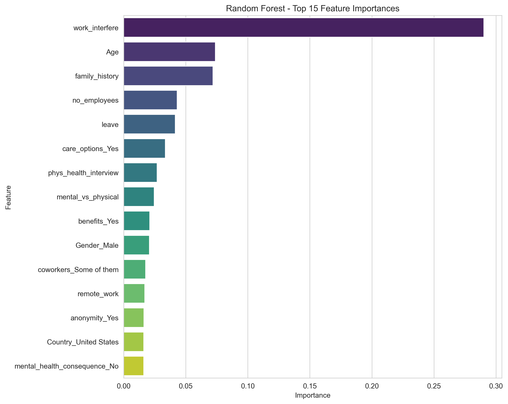
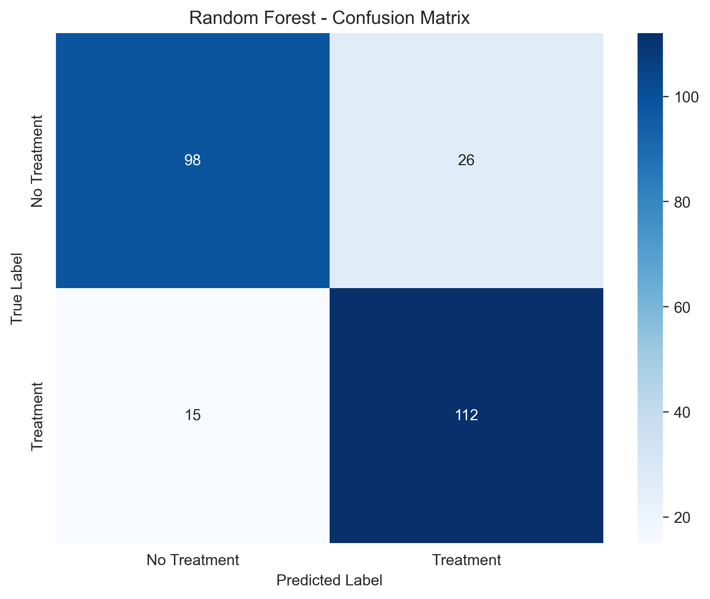
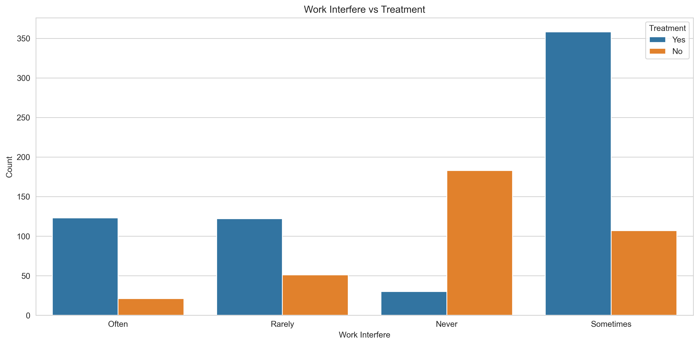
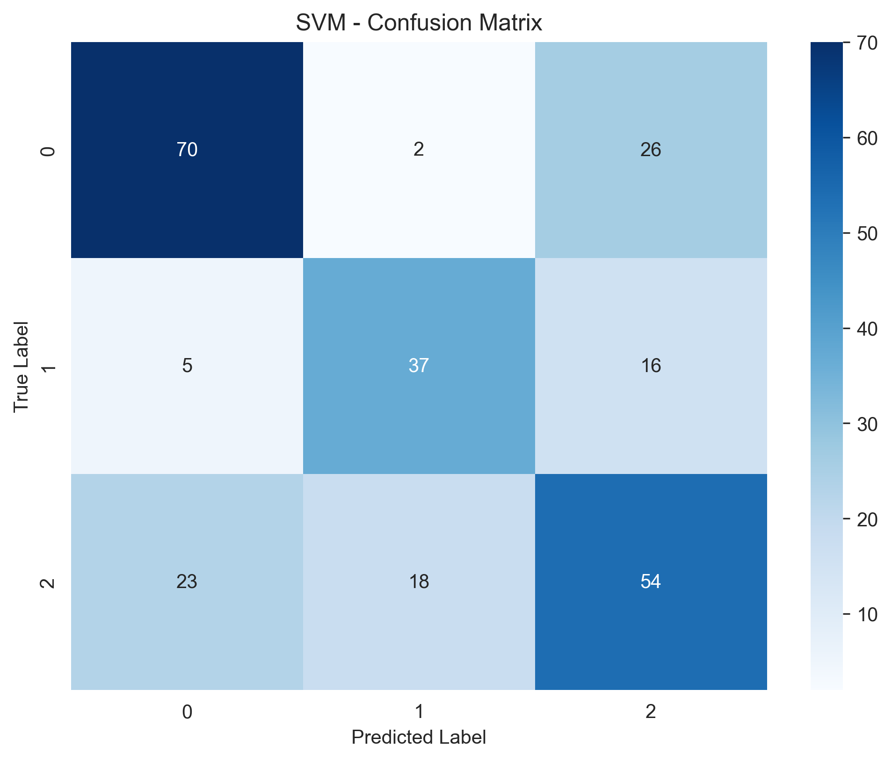
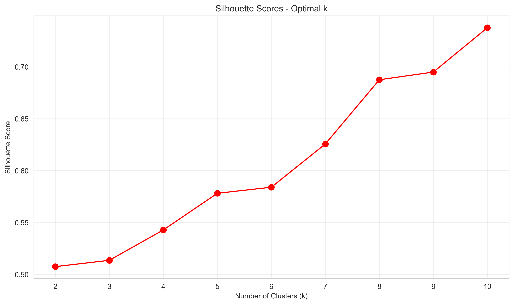

# Mental Health in Tech: Survey ML Analysis

Exploratory analysis and classical machine learning on the OSMI 2014 Mental Health in Tech Survey. The models predict who seeks treatment and how employees expect their employer to react, and look for workplace-culture clusters.


## Overview

The OSMI survey asks tech workers about their mental health, their employer's support, and their attitudes toward disclosure. This project runs as five notebooks with a small reusable preprocessing module:

1. **EDA** (`01_eda.ipynb`): data types, missing values, messy free-text `Gender` values (49 unique), extreme `Age` values (-1726 to 99,999,999,999), class balance, a correlation heatmap and treatment breakdowns.
2. **Preprocessing** (`02_preprocessing.ipynb` + `src/preprocessing.py`): drops `Timestamp`/`comments`/`state`, keeps ages 18 to 75, standardises gender, imputes missing values, maps ordinal columns by hand (`work_interfere`, `no_employees` as company-size midpoints, `leave`), label-encodes Yes/No-style columns and one-hot encodes the rest. Writes `data/cleaned_survey.csv`.
3. **Random Forest** (`03_random_forest.ipynb`): predicts `treatment` (sought mental-health treatment, yes/no). Uses a stratified 80/20 split, `class_weight='balanced'` and a `GridSearchCV` (5-fold, macro F1). Reports a confusion matrix and feature importances.
4. **K-Means** (`04_kmeans_clustering.ipynb`): clusters respondents on employer-related features. It uses the elbow method and silhouette scores for k = 2 to 10, fits a final k = 3 model, then profiles the clusters and their treatment rates.
5. **SVM vs Decision Tree** (`05_svm_decision_tree.ipynb`): 3-class prediction of `mental_health_consequence` (No / Yes / Maybe: "would discussing mental health with your employer have negative consequences?"). It rebuilds the target from its one-hot columns, removes the leaky `phys_health_consequence_*` columns and the sparse `Country_*` dummies, then tunes both models with `GridSearchCV` and compares them.

## Tech stack

| Tool | Used for |
|---|---|
| pandas, NumPy | Loading, cleaning and encoding the survey |
| scikit-learn | `RandomForestClassifier`, `KMeans`, `SVC`, `DecisionTreeClassifier`, `GridSearchCV`, `StandardScaler`, metrics |
| matplotlib, seaborn | All figures in `outputs/figures/` |
| joblib | Saving the trained models to `outputs/models/` |
| Jupyter | Running the analysis step by step |

Notes on some choices visible in the code:
- `class_weight='balanced'` handles the imbalance. A comment in notebook 05 records that SMOTE was tried and dropped.
- Features go through `StandardScaler` before K-Means and SVM, because both are distance/margin based. The tree models use unscaled features.
- Country dummies are dropped for the SVM/Decision Tree because the columns are sparse.

## Demo / Screenshots

Figures are produced by the notebooks and committed in `outputs/figures/`.

| Random Forest: feature importance | Random Forest: confusion matrix |
|---|---|
|  |  |

| Work interference vs treatment | SVM confusion matrix (0 = No, 1 = Yes, 2 = Maybe) |
|---|---|
|  |  |



## Dataset

- **Name:** [Mental Health in Tech Survey](https://www.kaggle.com/datasets/osmi/mental-health-in-tech-survey), from Open Sourcing Mental Illness (OSMI), 2014 survey, hosted on Kaggle.
- **License:** CC BY-SA 4.0.
- **Format/size:** one CSV, 1,259 rows x 27 columns. The columns hold demographics (Age, Gender, Country, state), employment (self-employed, company size, remote, tech company), employer support (benefits, care options, wellness program, anonymity, leave) and attitude questions, plus free-text comments.
- **Sensitivity:** the responses are anonymous but concern mental health. Treat the data with care.

**The dataset is not included in this repository.** Download `survey.csv` from Kaggle and place it like this:

```
mental-health-tech-ml/
└── data/
    ├── survey.csv            <- you add this
    └── cleaned_survey.csv    <- created by 02_preprocessing.ipynb
```

**Models** are not included either. Running notebooks 03 and 05 creates `outputs/models/random_forest.pkl`, `svm.pkl` and `decision_tree.pkl`. Notebook 04 writes `outputs/clustered_survey.csv`. All of these are git-ignored.

## Installation

The notebooks were last run on Python 3.11.

```bash
git clone https://github.com/aliyahseri/mental-health-tech-ml.git
cd mental-health-tech-ml
python -m venv .venv

# Windows
.venv\Scripts\activate
# macOS / Linux
source .venv/bin/activate

pip install -r requirements.txt
```

## Usage

The notebooks use paths relative to `notebooks/` (`../data`, `../src`, `../outputs`), so start Jupyter there and run them in order:

```bash
cd notebooks
jupyter notebook
```

1. `01_eda.ipynb`: reads `../data/survey.csv` and saves EDA figures
2. `02_preprocessing.ipynb`: writes `../data/cleaned_survey.csv` (required by 03 to 05)
3. `03_random_forest.ipynb`
4. `04_kmeans_clustering.ipynb`
5. `05_svm_decision_tree.ipynb`

Figures are saved to `outputs/figures/` and models to `outputs/models/`.

## Results

All numbers below are copied from the saved notebook outputs, with a test set of 251 respondents. **Caveat:** the saved outputs of notebook 02 come from an earlier version of the gender cleaning, which kept an "Other" category (1,251 rows, 78 columns). The current `src/preprocessing.py` drops those rows instead. Re-running the pipeline will therefore change the row count and the metrics below.

**Random Forest: `treatment` (binary, about 50/50 balanced)**

| Metric | Value |
|---|---|
| Accuracy | 0.8367 |
| Macro precision / recall / F1 | 0.8394 / 0.8361 / 0.8361 |
| Best 5-fold CV macro F1 | 0.8290 |
| Best params | `max_depth=20, min_samples_split=2, n_estimators=200` |

The top importances are `work_interfere` (0.29), `Age` (0.074), `family_history` (0.072), `no_employees` (0.043) and `leave` (0.042).

**K-Means: workplace culture**

With the final k = 3, the silhouette score is 0.5135 and the cluster sizes are 370 / 700 / 181. Treatment rates per cluster are 50.0% / 46.0% / 69.1%. The cluster with treatment rate 69.1% is the one where respondents had observed negative consequences for coworkers (`obs_consequence` = 1). Caveat: only 3 of the 8 intended features were actually used (see Known issues), and the silhouette score keeps rising up to k = 10 (0.7378). This analysis should be read as exploratory.

**SVM vs Decision Tree: `mental_health_consequence` (3 classes)**

| Metric (test, macro) | SVM | Decision Tree |
|---|---|---|
| Accuracy | 0.6414 | 0.5896 |
| Precision | 0.6420 | 0.5956 |
| Recall | 0.6402 | 0.5977 |
| F1 | 0.6411 | 0.5962 |

The best SVM was `C=0.1, gamma='auto', kernel='rbf'`. The best tree was `max_depth=4, min_samples_leaf=10, min_samples_split=30`. The "train/test accuracy" rows printed in notebook 05 are actually F1 scores (see Known issues).

## Project structure

```
mental-health-tech-ml/
├── data/
│   └── README.md              # where to put survey.csv (data not included)
├── notebooks/
│   ├── 01_eda.ipynb
│   ├── 02_preprocessing.ipynb
│   ├── 03_random_forest.ipynb
│   ├── 04_kmeans_clustering.ipynb
│   └── 05_svm_decision_tree.ipynb
├── outputs/
│   └── figures/               # PNGs produced by the notebooks
├── src/
│   ├── preprocessing.py       # cleaning + encoding pipeline
│   └── utils.py               # plotting / metrics helpers
├── requirements.txt
├── LICENSE
└── README.md
```

## Challenges & what I learned

- **Messy survey data:** `Gender` arrived as 49 free-text variants and `Age` included values such as -1726 and 99,999,999,999. Both needed explicit cleaning rules before modelling.
- **Encoding mixed column types:** some columns are truly ordinal (`work_interfere`, `leave`, company size) and were mapped by hand. Others are nominal and were one-hot encoded. Reconstructing a 3-class target from `drop_first` one-hot columns in notebook 05 showed how encoding choices made upstream affect later steps.
- **Data leakage:** notebook 05 drops the `phys_health_consequence_*` columns as leakage alongside the target's own columns. [TODO: confirm: was an earlier, near-perfect SVM/DT result the reason for this?]
- **Imbalance handling:** `class_weight='balanced'` was preferred over SMOTE (according to a comment in notebook 05). [TODO: confirm why SMOTE was dropped]
- **Model validation:** grid search with cross-validation, plus explicit train/test gap checks for the SVM and the Decision Tree.

## Known issues & limitations

- **Stale preprocessing outputs:** the saved outputs of `02_preprocessing.ipynb` show gender mapped to Male/Female/Other (19 "Other" rows kept, 78 columns). The current `clean_gender` in `src/preprocessing.py` drops every non-Male/Female row. Re-running notebook 02 changes the data, and therefore every downstream metric.
- **Gender cleaning excludes non-binary respondents:** `clean_gender` drops non-binary, genderqueer, trans and other answers it doesn't match. This is a methodology limitation and leaves out a group that matters for a mental-health study.
- **K-Means uses 3 of its 8 intended features:** `benefits`, `care_options`, `wellness_program`, `seek_help` and `anonymity` were one-hot encoded in preprocessing, so notebook 04's column lookup silently drops them. Clustering runs only on `leave`, `mental_vs_physical` and `obs_consequence` (`04_kmeans_clustering.ipynb`).
- **Every cluster is named "Supportive Workplace":** the naming thresholds (0.4 / 0.6) assume 0 to 1 features, but the cluster means range from 0.77 to 1.60. The interpretation text also mentions benefits and wellness programs, which were never used (`04_kmeans_clustering.ipynb`).
- **The chosen k is not the best by silhouette:** k = 3 is used, but the silhouette score rises steadily to k = 10 (`04_kmeans_clustering.ipynb`).
- **"Train/Test accuracy" in notebook 05 is F1:** `svm_grid.score` / `dt_grid.score` return the GridSearch scoring metric (weighted F1 for SVM, macro F1 for DT), not accuracy. The comparison table's "Train-Test Gap" subtracts test accuracy from train F1 (`05_svm_decision_tree.ipynb`).
- **SVM and DT are tuned on different metrics:** SVM uses `f1_weighted` and DT uses `f1_macro`, so their CV scores can't be compared directly (`05_svm_decision_tree.ipynb`).
- **Stale empty cell in notebook 05:** cell 2 has no source but still shows a saved output (`05_svm_decision_tree.ipynb`).
- **Decision tree figure shows a different model:** `decision_tree_visualization.png` is drawn from a separate `max_depth=4` tree without the tuned leaf/split constraints, not from the tuned `best_dt` (`05_svm_decision_tree.ipynb`).
- **Hard-coded RF interpretation:** the interpretation cell lists benefits and care options among the top predictors, which doesn't match the computed ranking. A misplaced `.format()` also prints the literal `{:.2f}` instead of the F1 score (`03_random_forest.ipynb`).
- **LabelEncoder on 3-valued columns:** `encode_binary_columns` applies `LabelEncoder` to any column with 3 or fewer values. Columns such as `mental_vs_physical` and `mental_health_interview` (Yes/No/Maybe or Don't know) therefore get an arbitrary alphabetical order (e.g. Don't know=0, No=1, Yes=2), and K-Means treats that order as numeric (`src/preprocessing.py`).
- **Missing NumPy import:** `plot_model_comparison` uses `np` but `src/utils.py` never imports NumPy, so calling it raises `NameError`. No notebook currently calls it.
- **Outdated project summary:** the markdown summary at the end of notebook 05 has outdated ranges ("~0.75-0.85", "depends on data") and cluster names that don't match the outputs.
- **Dataset limits:** a self-reported, cross-sectional 2014 survey whose sample may over-represent some regions. The results describe associations, not causes.

## Future improvements

- Re-run notebooks 02 to 05 against the current `src/preprocessing.py` so that outputs and code agree.
- Keep non-binary respondents, as their own category or by leaving gender out of the features.
- Cluster on the one-hot employer-support columns (or encode them ordinally) and name clusters from per-feature profiles.
- Report real train/test accuracy alongside the CV metric in notebook 05, and tune both models on the same metric.
- Replace `LabelEncoder` for 3-valued answers with explicit mappings or one-hot encoding.
- Wrap preprocessing and models in a scikit-learn `Pipeline` with cross-validated evaluation.

## Credits / Acknowledgements

- **Dataset:** [OSMI Mental Health in Tech Survey (2014)](https://www.kaggle.com/datasets/osmi/mental-health-in-tech-survey) by Open Sourcing Mental Illness, licensed CC BY-SA 4.0. The dataset is not redistributed here.
- Built with scikit-learn, pandas, NumPy, matplotlib and seaborn.

## License

MIT, see [LICENSE](LICENSE). The dataset keeps its own CC BY-SA 4.0 license.

## Author

**Aliyah Seri**
- GitHub: [aliyahseri](https://github.com/aliyahseri)
